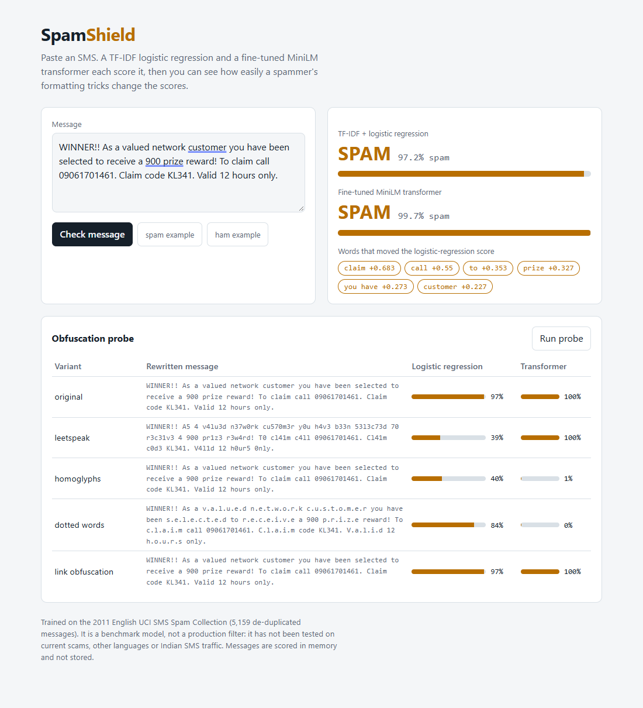
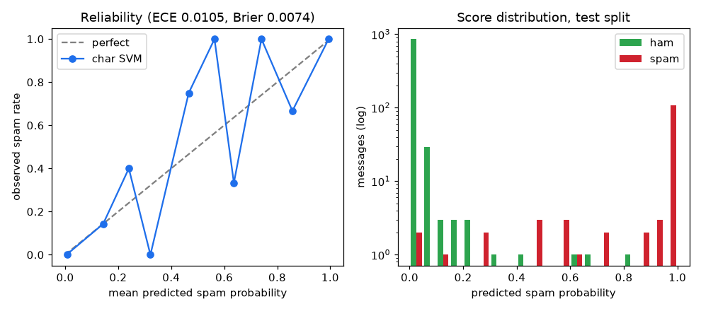

# SpamShield: SMS spam detection, classical vs transformer, with robustness analysis

**Live demo:** _(link added after deploy)_ A free Render instance (`render.yaml`, service `spamshield-demo`) serving the calibrated char n-gram SVM with the inspection UI. The free tier sleeps when idle, so the first request after a pause can take about a minute. Messages are not stored; requests are limited to 8 KB and 30 per minute per client.

A reproducible benchmark of four spam classifiers on identical splits (TF-IDF logistic regression, TF-IDF naive Bayes, character n-gram SVM, and a fine-tuned MiniLM transformer), a test of how each one holds up against spammer obfuscation tricks, and a small FastAPI service with an inspection UI. No API key or GPU required (the transformer was fine-tuned on a laptop CPU).



## Results (UCI SMS Spam Collection, 5,159 de-duplicated messages, 1,032 held-out test messages)

Reproduce: `python benchmark.py` (about 25 minutes on a 12-thread laptop CPU, mostly the transformer; `--skip-transformer` takes about 2 minutes). Output: [`reports/benchmark.json`](reports/benchmark.json). Hyper-parameters were chosen on the validation split, every model was refit on train+validation, and the test split was scored once. Threshold 0.5 for all models.

| Model | Spam precision | Spam recall | Spam F1 (95% CI) | PR-AUC | FP / FN | Batch-1 latency (median) |
| --- | --- | --- | --- | --- | --- | --- |
| TF-IDF word n-grams + logistic regression (original baseline) | 0.917 | 0.945 | 0.931 (0.897-0.961) | 0.982 | 11 / 7 | 1.7 ms |
| TF-IDF word n-grams + naive Bayes | 0.975 | 0.898 | 0.935 (0.899-0.964) | 0.971 | 3 / 13 | 3.7 ms |
| TF-IDF character 2-5-grams + linear SVM (calibrated) | 0.976 | 0.938 | 0.956 (0.927-0.980) | 0.992 | 3 / 8 | 4.0 ms |
| Fine-tuned MiniLM-L6 transformer (3 epochs, seed 42, 21 min CPU training) | 0.954 | 0.969 | **0.961** (0.934-0.985) | 0.995 | 6 / 4 | 46 ms |

What this does and does not show:

- The transformer has the highest point estimate, but **its advantage over the best classical model is not statistically distinguishable**: an exact McNemar test between the character SVM and the transformer gives 7 vs 8 discordant messages, p = 1.0. All four 95% intervals overlap. A 1,032-message test set (about 128 spam) cannot rank these models.
- Intervals are bootstrap intervals over test messages. **The transformer was trained with one seed**; training variance is not measured. The latency numbers are single-message, model-only timings on a shared laptop, indicative only.
- The 2011 English corpus is easy: the dumbest reasonable model already scores 0.93 F1. Absolute numbers do not carry over to current SMS traffic.

## Robustness to obfuscation

Spam recall on the 128 test spam messages after deterministic text tricks (`python benchmark.py`, table in `reports/benchmark.json`):

| Model | Clean | Leetspeak (a->4, e->3 ...) | Look-alike (Cyrillic) letters | Dotted words (f.r.e.e) | Link tricks (hxxp, www .) |
| --- | --- | --- | --- | --- | --- |
| Word TF-IDF + logistic regression | 0.945 | 0.547 | 0.484 | 0.914 | 0.945 |
| Word TF-IDF + naive Bayes | 0.898 | 0.773 | 0.719 | 0.828 | 0.898 |
| Character n-gram SVM | 0.938 | 0.945 | 0.836 | 0.859 | 0.930 |
| Fine-tuned MiniLM transformer | 0.969 | 1.000 | **0.281** | **0.383** | 0.969 |

The headline finding: the most accurate clean-data model (the transformer) is the most brittle to look-alike characters and dotted words, because its WordPiece vocabulary shatters a perturbed word into unrelated pieces, while character n-grams degrade gracefully. Unicode normalization and homoglyph folding in front of the model, or training with perturbed examples, would be the next fix; neither is done here. These perturbations are simple, fixed, and not adaptive attacks. The UI has a probe that applies the same tricks to your own message.

## Why the simpler model ships

The service's primary model is the **character 2-5-gram TF-IDF linear SVM with probabilities calibrated by `CalibratedClassifierCV`**, not the transformer and not the original logistic regression. The evidence, all from the tables above:

- On clean test data it matches the transformer: F1 0.956 vs 0.961, McNemar p = 1.0 (7 vs 8 discordant messages), overlapping intervals. Nothing here says the transformer is better.
- Under obfuscation it is far more robust: recall 0.945 / 0.836 on leetspeak / look-alike letters versus 1.000 / 0.281 for the transformer (dotted words 0.859 vs 0.383).
- It is about 11x faster per message (4.0 ms vs 46 ms batch-1, indicative) and is a 1.4 MB scikit-learn file instead of a PyTorch stack.
- It beats the original word-level logistic regression on F1 (0.956 vs 0.931) and by a wide margin on the obfuscation columns.

The transformer stays as an optional second opinion: if `models/transformer` exists, `/predict` also returns its score. Caveats: these are one-seed, one-corpus (2011 English) results on a 1,032-message test set, and the obfuscations are fixed, non-adaptive tricks; the choice is evidence-based, not proof. Calibration of these probabilities: ECE 0.0105, Brier 0.0074 ([`MODEL_CARD.md`](MODEL_CARD.md), [`reports/calibration.png`](reports/calibration.png)); the middle bins hold very few messages.

## Serving

### Hosted demo (Docker, Render free tier)
`Dockerfile` installs only `requirements-serve.txt` (FastAPI, uvicorn, scikit-learn, joblib; no torch or transformers) and copies the committed `models/spamshield_svm.joblib` (1.4 MB; retraining with `python benchmark.py --export-primary` reproduces the reported test F1 0.9562 / PR-AUC 0.9916, max probability difference 9e-7). Build and run: `docker build -t spamshield-demo .` then `docker run -m 512m -e PORT=10000 -p 8000:10000 spamshield-demo`. Measured with `docker stats --no-stream` after classifying several messages: about 110 MiB. `/health` is the Render health check; `/predict` and `/probe` return 413 above 8 KB and 429 beyond `SPAMSHIELD_RATE_LIMIT` (default 30) requests per minute per client address (in-memory, per process).

```powershell
pip install -r requirements.txt -r requirements-serve.txt
python benchmark.py --export-primary      # about 1 minute: fits the shipped character n-gram SVM -> models/spamshield_svm.joblib
python benchmark.py                       # optional: also writes models/transformer, shown as a second opinion (kept out of git)
uvicorn spam_api:app --port 8000          # UI at /, docs at /docs
```

`POST /predict {"message": ...}` returns the primary (character n-gram SVM) spam probability, the transformer's as a second opinion if its weights are present, and the character n-grams that moved the primary score; `POST /probe` re-scores obfuscated variants. Messages are not stored. Tests: `python -m pytest tests -q` (13 passed).

## Out-of-domain / drift evaluation: not done

No second SMS corpus with a clear licence that permits redistribution or download by script was identified, so no out-of-domain number is reported. Random splits of one 2011 corpus are not a drift test; do not read these results as robustness to new scams.

## Original baseline script (Windows PowerShell)

```powershell
python -m venv .venv
.\.venv\Scripts\python -m pip install -r requirements.txt
.\.venv\Scripts\python spamshield.py train
.\.venv\Scripts\python spamshield.py predict "Congratulations! Claim your free prize now"
.\.venv\Scripts\python spamshield.py predict "Please call me when you get home"
```

If environment creation reports an ensurepip error, bootstrap packages using the system pip:

```powershell
python -m pip --python .venv\Scripts\python.exe install -r requirements.txt
```

The first training run downloads the public dataset. Subsequent runs use the local copy. Predictions run locally after training.

## Experiment design

1. Validate records, normalize whitespace and case for duplicate detection, remove duplicate messages and conflicting label groups.
2. Create stratified 60% training, 20% validation, and 20% test partitions with seed 42.
3. Fit TF-IDF word unigrams and bigrams inside each model pipeline, using only training text.
4. Compare a majority predictor, Multinomial Naive Bayes, and class-balanced logistic regression on validation spam F1.
5. Refit the winning pipeline on training plus validation data; evaluate once on the held-out test set.
6. Save the model, metrics, dataset hash, runtime versions, confusion matrix and misclassified examples.

`reports/metrics.json` contains measured results. `reports/errors.csv` supports qualitative error analysis. The model is saved to `models/spamshield.joblib`; load only artifacts you trust.

## Limitations and next experiments

This is an educational benchmark, not a production spam filter. The historical English SMS corpus does not establish performance on current scams, email, multilingual messages or Indian SMS traffic. Deduplication removes exact normalized matches, but near-duplicate templates may remain. The random split is not a temporal evaluation. Batch latency is a local measurement and excludes model loading.

For a stronger second version, predefine a cross-validation protocol on development data, compare character n-grams, inspect precision/recall tradeoffs, and collect a separate recent consented evaluation set. Avoid repeatedly using this test set to select improvements.

## Dataset and attribution

Almeida, T. & Hidalgo, J. (2011). *SMS Spam Collection*. UCI Machine Learning Repository. DOI: https://doi.org/10.24432/C5CC84.

Source: https://archive.ics.uci.edu/dataset/228/sms+spam+collection

Dataset license: CC BY 4.0. Downloaded raw data is kept out of Git. Do not treat benchmark messages as real contacts or redistribute personal details in demo screenshots.

## Original baseline results (first version)

### Held-out test results

After deduplication, this experiment used 5,159 messages: 3,095 training, 1,032 validation and 1,032 test. Logistic regression won validation model selection. On the held-out test set it achieved **98.26% accuracy**, **91.67% spam precision**, **94.53% spam recall** and **93.08% spam F1**. There were 11 false positives and 7 false negatives. See the full metrics file for baseline comparisons and environment versions.

`requirements-lock.txt` records the installed packages from this run. To reproduce this environment, use `python -m pip --python .venv\Scripts\python.exe install -r requirements-lock.txt`.

## Verification

Run `python -m unittest discover -s tests -v` (or `python -m pytest tests -q`). The offline suite checks deduplication, conflicting labels, invalid input and the train/save/reload/predict workflow. GitHub Actions runs these checks on pushes and pull requests. Synthetic test fixtures are used only for software checks; reported benchmark metrics come from the UCI data.

Raw data, local model artifacts and message-level error exports are excluded from Git. The aggregate benchmark report is included in `reports/metrics.json`.

## License

MIT. See [LICENSE](LICENSE). The UCI dataset is CC BY 4.0.

## Error analysis, calibration and model card

`python scripts/error_analysis.py` (needs `requirements-analysis.txt`) writes [`reports/error_analysis.md`](reports/error_analysis.md) (every false positive/negative with its score and a rough category), `reports/calibration.json` and `reports/calibration.png`. See [`MODEL_CARD.md`](MODEL_CARD.md) for scope, measured numbers and limits.


